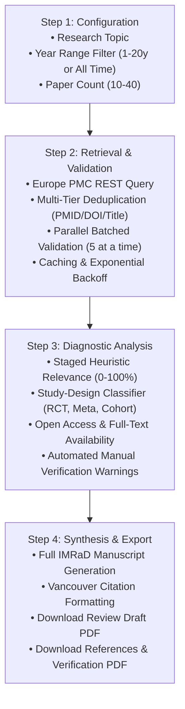

# SciDraft AI 🔬📄

> **AI-Assisted Literature Review Draft Platform**  
> Transform any biomedical or scientific research topic into a structured, publication-grade academic paper draft with validated **Vancouver (ICMJE)** references, heuristic relevance scoring, study-design classification, and dual PDF exports.

[](LICENSE)
[](https://scidraft-ai.vercel.app)
[](https://europepmc.org)
[](https://www.nlm.nih.gov/bsd/uniform_requirements.html)
[](#)
[](#)

---

## 🌟 Highlights

- **100% Free & Unauthenticated**: Uses the open Europe PMC REST API (EMBL-EBI). Zero API keys, logins, or tokens required.
- **Single-File Zero-Download Architecture**: Fully self-contained client-side application (`index.html`) ready to run in any modern web browser.
- **Vancouver Citation Compliance**: Strict adherence to National Library of Medicine (NLM) and ICMJE standards with automatic in-text numeric citation linking (`[1]`, `[2]`).
- **High-Throughput Batched Validation**: Parallel reference verification in batches of 5 with exponential backoff retry and in-memory caching (`⚡`).
- **Resilient, Actionable Error Handling**: Categorized, non-dismissing alerts for rate limits (HTTP 429), network drops, and zero-match queries with instant retry and parameter reduction.
- **Dual Publication-Grade PDF Exports**: Download both the full review manuscript and a dedicated references verification table with clean academic typography.
- **Mobile-Optimized Experience**: Sticky bottom action bar, touch-scrolling stepper, full-width touch targets, and single-page continuous reading on mobile devices.

---

## 📐 Pipeline Workflow



---

## ✨ Features

### 1. 🔍 Europe PMC API Integration & Deduplication
- Direct querying of millions of biomedical and life sciences records indexed in Europe PMC (MEDLINE, PubMed Central, and preprint repositories).
- Multi-tier deduplication engine eliminates duplicate records using PMID, registered DOI, or normalized alphanumeric title fingerprints.

### 2. ⚡ High-Performance Parallel Batch Validation
- Validates up to 40 references in controlled **batches of 5 concurrent requests** via `Promise.all`.
- Live visual progress counters (`"Validating references: 12 of 30 completed (40%)"`).
- **In-Memory Caching (`VALIDATION_CACHE`)**: Immediate retrieval for previously inspected citations with visual cached indicators (`⚡`).
- **Exponential Backoff**: Automatic retry (up to 2 retries) with jittered backoff (`400ms` $\rightarrow$ `800ms+`) for HTTP 429 rate limits and transient connection blips.
- **AbortController Support**: Instant, non-blocking cancellation via the `⏹ Cancel Operation` button.

### 3. 📊 Staged Heuristic Relevance Scoring Model
- Multistage scoring model evaluated across title, abstract, keywords, and metadata:
  - **Stop-word filtration**: Removes generic and noise words.
  - **Phrase detection**: Evaluates multi-word conceptual alignment.
  - **Biomedical synonym expansion**: Expands terms across oncology, genetics, immunology, neurology, and endocrinology.
  - **MeSH descriptor scoring**: Rewards indexed Medical Subject Headings.
  - **Recency score**: Grants recency weighting for contemporary findings.
  - **Diagnostic explanation tags**: Displays badges such as `🎯 High title match`, `🔬 Strong abstract evidence`, `📅 Recent publication`, or `⚠️ Weak match`.

### 4. 🏷️ Study-Design & Access Classification
- **Study-Design Categorization**: Classifies studies into **Randomized Controlled Trial (RCT)**, **Systematic Review / Meta-Analysis**, **Cohort Study**, **Case-Control Study**, **Cross-Sectional Study**, **Experimental / Laboratory Study**, or **Review / Editorial**.
- **Full-Text Availability Badges**: Detects Open Access articles (`🟢 Open Access (PMC Full-Text)`) and provides direct resolver URLs (`https://doi.org/...` or `https://europepmc.org/article/PMC/...`).

### 5. 🛡️ Persistent & Actionable Error Handling
- Errors never auto-hide or dump user input:
  - **Inline Topic Alerts**: Validates required inputs with focus restoration.
  - **HTTP 429 Rate Throttling**: Displays actionable choices to retry immediately or reduce paper count.
  - **Zero Results**: Recommends broadening the year window or expanding terms to "All time".
  - **Partial Validation Warnings**: Highlights verified vs. unverified counts with direct PubMed/DOI links.

### 6. 📄 Dual Academic PDF Export
- **Review Draft PDF**: Formatted in standard academic IMRaD format (Title, Abstract, Keywords, 1. Introduction, 2. Methods, 3. Results, 4. Discussion, 5. Conclusion, References) with running headers and page numbering.
- **References & Verification PDF**: Dedicated tabular reference audit report containing Vancouver reference entries, study design classifications, access status, heuristic relevance scores, and verification flags.

### 7. 📱 Mobile-First Design
- **Sticky Bottom Action Bar**: Fast thumb-access to generate drafts or download PDFs without scrolling through dozens of cards.
- **Horizontally Scrollable Stepper**: Touch-friendly step tracker with auto-centering on the active step.
- **Single-Page Continuous Scroll**: Removes inner scroll traps for seamless phone reading.
- **1-Column Selection Controls**: Comfortable tap targets for year and paper count choices.

---

## 🚀 Quick Start

### Option A: Zero Install (Direct in Browser)
1. Clone or download this repository:
   ```bash
   git clone https://github.com/roroleaks/scidraft-ai.git
   cd scidraft-ai
   ```
2. Double-click `index.html` to open it in Chrome, Edge, Firefox, or Safari.

### Option B: Local Node.js Server
1. Run the lightweight local server:
   ```bash
   npm start
   # or: node server.js
   ```
2. Open your browser and navigate to:
   ```
   http://localhost:3000
   ```

---

## 📖 Citation Format (Vancouver Style)

SciDraft AI formats all citations in strict compliance with the **Uniform Requirements for Manuscripts Submitted to Biomedical Journals (ICMJE / Vancouver Style)**:

```text
1. Author AA, Author BB, Author CC, et al. Article Title. Journal Abbreviation. Year;Volume(Issue):Pages. doi:10.xxxx/xxxx. PMID: xxxxxxxx.
```

- In-text references are dynamically mapped and numbered in order of first appearance: `[1]`, `[2]`, `[3]`.
- Up to 6 authors are listed; studies with more than 6 authors are truncated with `et al.` per NLM guidelines.

---

## 🛠️ Technology Stack

- **Frontend**: HTML5, Embedded CSS, Vanilla ES6+ JavaScript (Zero frameworks, zero bundlers).
- **Typography & Styling**: Modern responsive academic UI with custom AIMed theme palette.
- **External Libraries (via CDN)**:
  - [jsPDF 2.5.1](https://cdnjs.com/libraries/jspdf): Client-side vector PDF document generation.
- **APIs**: [Europe PMC REST Web Service](https://europepmc.org/RestfulWebService) (EMBL-EBI).

---

## 👨‍⚕️ Author & Attribution

**Dr. Raouf Roshdy**  
*Creator & Lead Architect, SciDraft AI*  
Project: **AIMed Biomedical Informatics Initiative**

---

## 📄 License

This project is licensed under the [MIT License](LICENSE) — free for educational, academic, and research use. Always verify AI-synthesized literature reviews clinically and academically.
